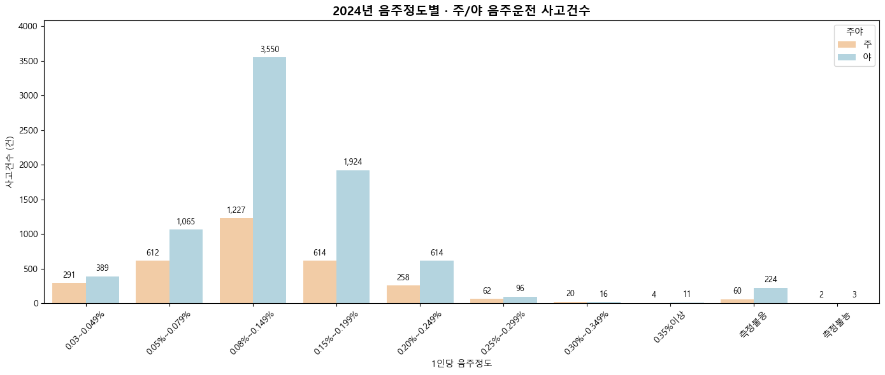
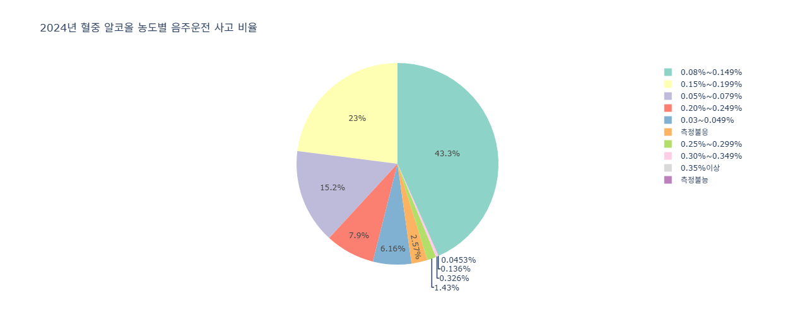
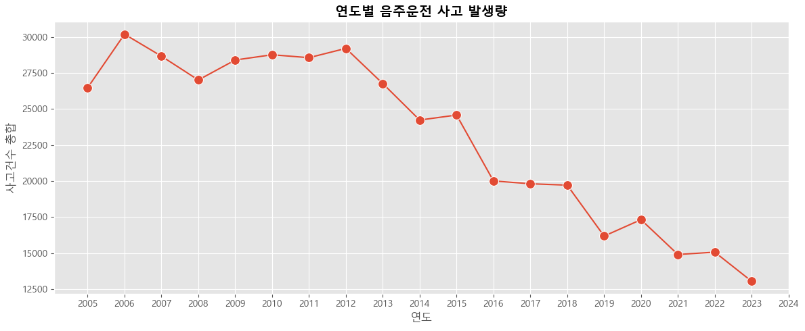
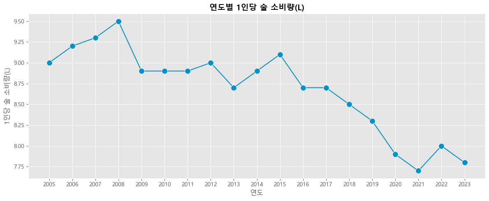
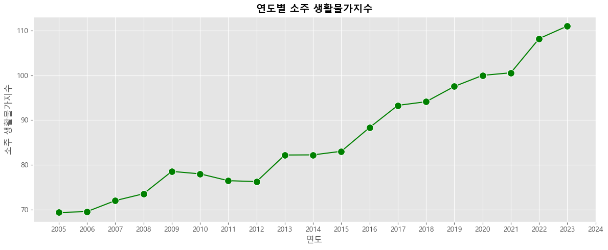
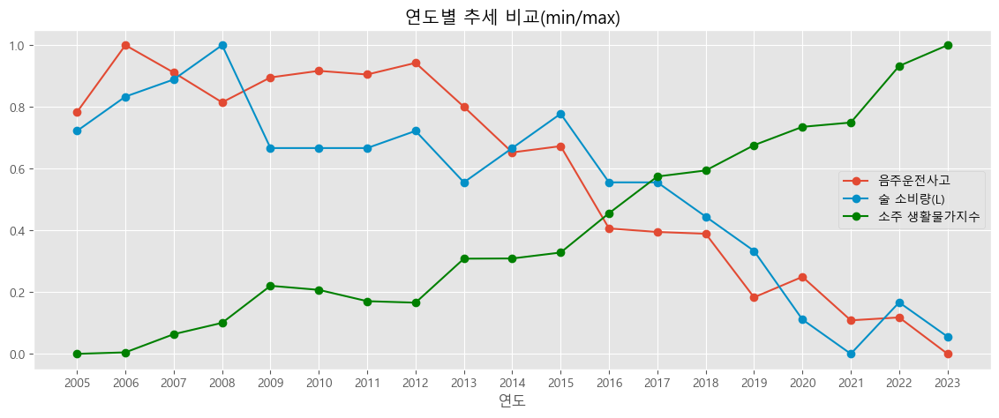
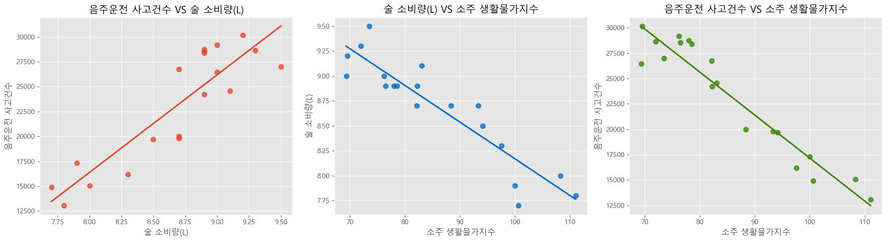
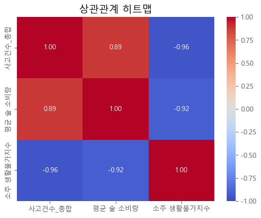

# 🍶 음주운전 · 술 소비량 · 소주 물가지수 상관관계 분석

KDT 빅데이터/AI 부트캠프 12기 · 데이터 분석 기본 과정 팀 프로젝트 (팀명: 티키타카)

공공데이터를 이용해 **음주운전 사고건수, 1인당 술 소비량, 소주 생활물가지수**의 관계를 Python으로 시각화하고 분석했습니다.

| 항목 | 내용 |
|---|---|
| 개발 기간 | 2026.01.13 ~ 2026.01.20 (8일) · 01.21 발표 |
| 팀 구성 | 2인 (팀장 · 총무) |
| 담당 업무 | 술 관련 데이터 정제 · 정규화, 데이터 시각화, 관련 자료 탐색, PPT 제작 |
| 사용 기술 | Python, pandas, seaborn, matplotlib, plotly |
| 분석 기간 | 2005 ~ 2023 (19개 연도) |

## 1. 프로젝트 개요

- **주제 선정 이유**: 코로나 이후 술 소비량은 줄었지만 음주운전 사고 기사는 계속 나오고 있어, 술 소비량·가격과 음주운전의 관계를 데이터로 확인해 보고자 했습니다.
- **가설**: 사람들이 술을 많이 마시면 음주운전 사고도 늘어날 것이다.
- **목표**: 파이썬으로 데이터를 시각화·분석하고, 결과를 토대로 음주운전을 줄일 방법을 생각해 본다.

| 구분 | 기간 | 내용 |
|---|---|---|
| 사전 기획 | 01/13 ~ 01/15 | 아이디어 선정 |
| 데이터 수집 | 01/15 ~ 01/16 | 공공 데이터 탐색 |
| 데이터 전처리 | 01/16 | 정제 · 정규화 |
| 데이터 시각화 | 01/17 ~ 01/19 | 그래프, 상관계수 도출 (중간보고) |
| 마무리 | ~ 01/20 | PPT 제작 |

## 2. 데이터와 전처리

| 데이터 | 출처 | 사용한 값 |
|---|---|---|
| 가해자 음주정도별 · 주야별 교통사고 | KOSIS | 연도별 사고건수 (2005 ~ 2024) |
| 생활물가지수 (2020년 = 100) | KOSIS | 소주 항목 (1995 ~ 2025) |
| Alcohol consumption | OECD | 한국의 1인당 술 소비량(L) (1961 ~ 2023) |

**전처리 과정**

1. 엑셀의 병합 셀 때문에 비어 있던 분류 값을 `ffill()`로 채움
2. 음주와 관계없는 `정상운전` 행을 제거하고 연도별 사고건수를 합산
3. OECD 데이터에서 `REF_AREA == "KOR"`만 골라 연도와 술 소비량만 남김
4. 생활물가지수에서 `소주` 열만 추출
5. 세 데이터를 연도 기준으로 병합해 **2005 ~ 2023년 19개 행**의 분석용 표를 만듦

## 3. 시각화와 분석 결과

### 3-1. 2024년 혈중알코올농도별 사고 (주/야)




- 2024년 사고는 총 11,042건이고, **0.08 ~ 0.149% 구간이 4,777건(43.3%)** 으로 가장 많았습니다. 다음은 0.15 ~ 0.199%(23.0%), 0.05 ~ 0.079%(15.2%) 순입니다.
- 0.08% 이상은 면허취소 기준에 해당하는 구간인데, 이 구간의 사고가 전체의 약 76%(8,396건)입니다.
- 대부분의 농도 구간에서 **낮보다 밤에 사고가 많았습니다.** 0.08 ~ 0.149% 구간은 야간 3,550건, 주간 1,227건입니다.

### 3-2. 연도별 추이



- 음주운전 사고는 2006년 30,185건으로 정점을 찍은 뒤 줄어들어 **2024년 11,042건(약 63% 감소)** 이 되었습니다. 2013 ~ 2014년경과 2019년경에 도로교통법 개정이 있었고, 그 무렵 감소가 뚜렷합니다.



- 1인당 술 소비량은 2008년 9.5L에서 2021년 7.7L로 줄었습니다. 2022년에 8.0L로 반등했는데, 사회적 거리두기 해제 시점과 겹칩니다.



- 소주 생활물가지수는 2005년 69.3에서 2023년 111.0으로 꾸준히 올랐습니다.



- 세 지표를 0~1로 정규화(min-max)해 겹쳐 보면, 사고건수와 술 소비량은 함께 내려가고 소주 물가지수는 반대로 올라갑니다.

### 3-3. 상관관계




| | 사고건수 | 술 소비량 | 소주 물가지수 |
|---|---|---|---|
| 사고건수 | 1.00 | **0.89** | **-0.96** |
| 술 소비량 | 0.89 | 1.00 | **-0.92** |
| 소주 물가지수 | -0.96 | -0.92 | 1.00 |

- 음주운전 사고와 술 소비량은 **강한 양의 상관**(0.89)입니다. 가설과 같은 방향의 결과입니다.
- 소주 물가지수는 사고건수, 술 소비량과 모두 **강한 음의 상관**(-0.96, -0.92)입니다.

## 4. 결론

- 술 소비량과 음주운전 사고 사이에 매우 강한 상관관계가 있었습니다.
- 술 가격이 올라 술에 접근하는 문턱이 높아지면 음주운전을 줄일 수 있을 것으로 보았습니다.
- 음주운전 관련 법률을 강화하는 것도 음주운전을 줄이는 방법으로 제안했습니다.

## 5. 한계와 개선 방향

- **자료 양**: 분석에 쓴 데이터가 19개 연도뿐이라 상관계수가 크게 흔들릴 수 있습니다.
- **비교 항목**: 비교한 항목이 3개뿐이라 다양한 관점에서 접근하지 못했습니다.
- **추세의 영향**: 세 지표 모두 연도에 따라 한 방향으로 움직이는 추세가 있어, 상관계수가 높아도 원인과 결과로 단정할 수는 없습니다.
- **개선**: 음주운전과 관련된 추가 데이터를 모아 회귀분석으로 영향의 크기를 확인해 볼 계획입니다.

## 6. 파일 구성

```
Phase2/
├── README.md
├── drunk_driving_analysis.ipynb   분석 노트북 (전처리 · 시각화 · 상관분석)
└── images/                        노트북에서 추출한 그래프
```

## 실행 방법

노트북은 아래 경로에 데이터 파일이 있다고 가정하고 작성되었습니다. KOSIS와 OECD에서 내려받아 같은 이름으로 두어야 합니다.

```
./data/project/OECD.ELS.HD,DSD_HEALTH_LVNG@DF_HEALTH_LVNG_AC,1.0+all.csv
./data/project/가해자_음주정도별_교통사고.xlsx
./data/project/생활물가지수_2020100__20260119154113.xlsx
```

한글 글꼴 경로(`malgun.ttf`)는 작성 당시 실습 PC 기준이라, 다른 환경에서는 본인 PC의 글꼴 경로로 바꿔야 합니다.
